# Octopus Agile 24h for TRMNL

The next 24 hours of [Octopus Agile](https://octopus.energy/smart/agile/) electricity prices on a
[TRMNL](https://trmnl.com) e-ink display: what you're paying right now, the best 2 hours to run the
dishwasher or charge the car, and the 2 hours to avoid.

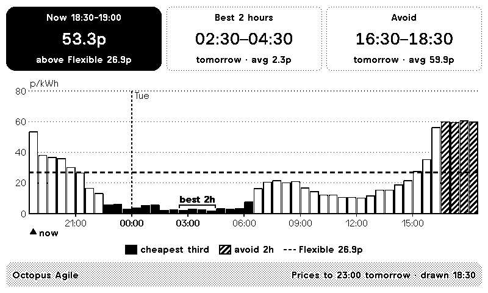

**[Install the recipe on TRMNL](https://trmnl.com/recipes/octopus-agile-24h-512180)** and pick your
region. It reads Octopus's public price API, so there's no Octopus account, API key or server to run.

## What's on the screen

| On screen | What it means |
|---|---|
| **Now** (black box) | The current half-hour and its price in p/kWh inc VAT, and whether it's above or below your Flexible rate. |
| **Best 2 hours** | The cheapest 2-hour stretch in the next 24 hours, with its average price. |
| **Avoid** | The most expensive 2-hour stretch, usually the 4–7pm peak. |
| **Bars** | One bar per half-hour, always 24 hours from now (▲ now is the first bar). |
| ■ **Black bars** | The cheapest third of the prices shown. |
| ▨ **Hatched bars** | The 2 hours to avoid. |
| **Dashed line** | Your Flexible Octopus rate, for comparison. Leave the setting blank to hide it. |
| **best 2h** bracket | Marks the best 2 hours on the chart. |
| **Day divider** | The dotted line at midnight, labelled with the day. |
| **Footer** | How far ahead prices are published ("Prices to 23:00 tomorrow") and when the screen was drawn. |

Everything is black, white and hatching, so it reads the same on a 1-bit TRMNL OG as on a greyscale TRMNL X.

### Before and after 4pm

Octopus publishes the next day's Agile prices at around 4pm. Before then, the hours not yet priced
show as an empty "next prices ~4pm" box, and best/avoid only look at the hours that are known.

| Morning (tomorrow not published yet) | Evening (full 24 hours) |
|---|---|
| 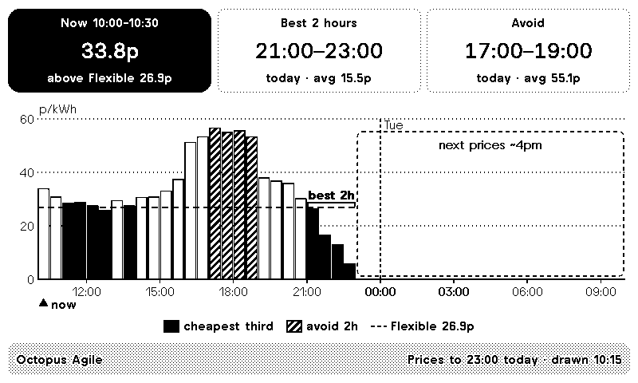 |  |

## How it works

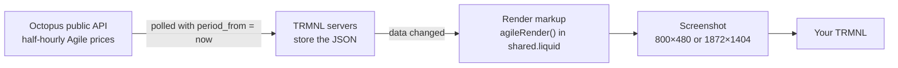

1. **TRMNL polls Octopus.** The polling URL asks for your region's Agile unit rates from the current
   half-hour onwards (`period_from` is the time of the poll). Octopus returns every published price
   from now to 23:00 today, or 23:00 tomorrow once the next day is out after ~4pm.
2. **The data only changes at :00 and :30.** For the whole half-hour, a poll gets the same answer,
   and TRMNL only redraws when the data changes. So the screen is redrawn about once per half-hour,
   just after the current half-hour changes. TRMNL can't wake your device at an exact time, so it
   can lag by up to your device's refresh interval (15 minutes, or 5 with TRMNL+).
3. **The markup does the maths.** `agileRender()` in `src/shared.liquid` runs in TRMNL's renderer.
   It lays the prices onto 48 half-hour slots starting now, in UK time, then works out:
   - **cheapest third:** a price at or below the one-third mark of the prices shown;
   - **best 2 hours / avoid:** the 4 consecutive half-hours with the lowest / highest average;
   - **above / below Flexible:** the current price against your Flexible setting.
4. **It fits the screen.** The boxes and legend are TRMNL Framework components, so text and spacing
   follow each device. The chart is an SVG that fills the space left and uses the Framework's font.

### When Octopus can't be reached

Published Agile prices never change, so if Octopus stops answering, the screen keeps working from the
last prices it fetched: "Now", best/avoid and the chart still move on with the clock, the footer says
"Octopus offline since 12:00", and anything past the old data is marked "Octopus unreachable".
If the old prices run out, or a poll returns nothing, it says "Unable to reach Octopus servers".

| Offline, still on earlier prices | Offline, earlier prices ran out |
|---|---|
| 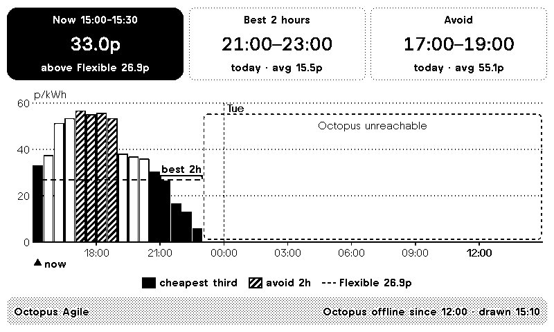 | 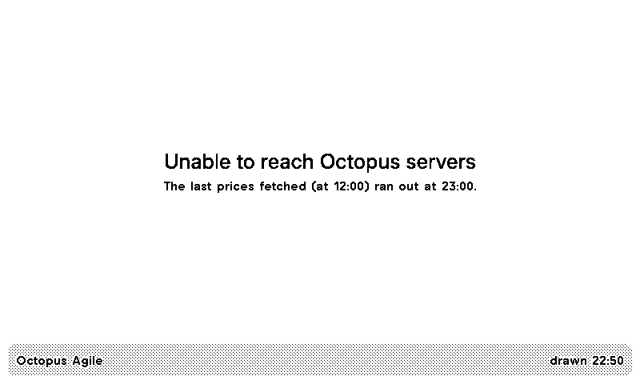 |

This relies on TRMNL drawing the screen with the last successful poll's data, which its docs don't spell out.

## Layouts and screens

Every TRMNL layout is supported. Mashups show fewer boxes and a smaller chart.

| Half horizontal | Half vertical | Quadrant |
|---|---|---|
| 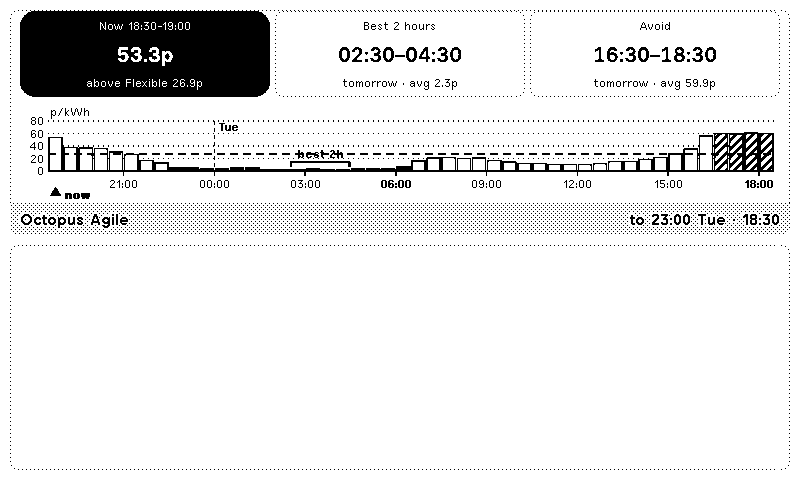 | 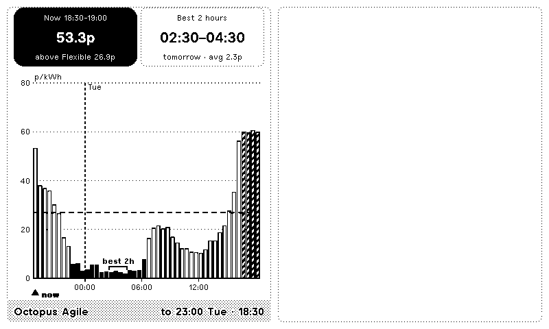 | 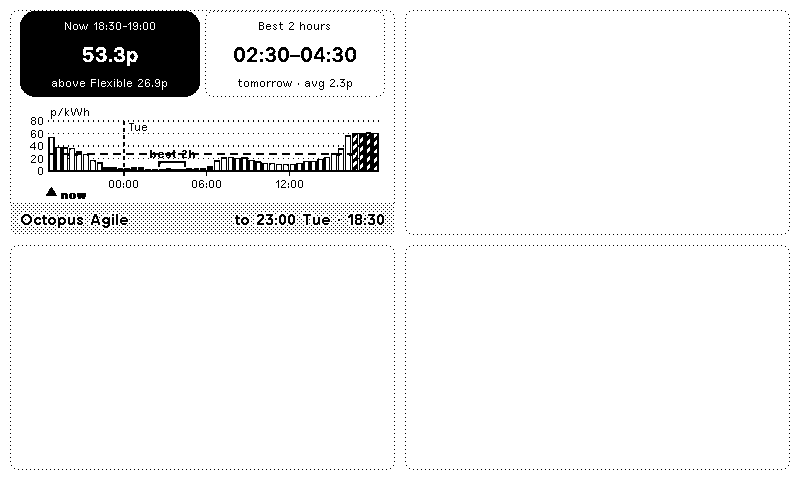 |

On a **TRMNL X** the text is larger, and in **portrait** the boxes stack above a taller chart:

| TRMNL X | TRMNL X portrait | TRMNL OG portrait |
|---|---|---|
| 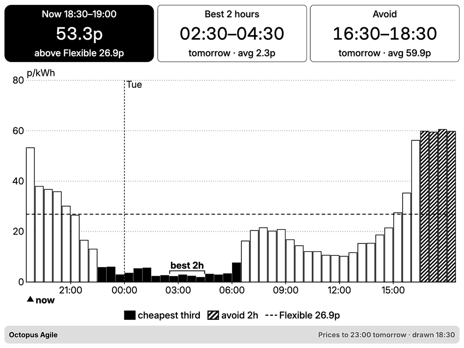 | 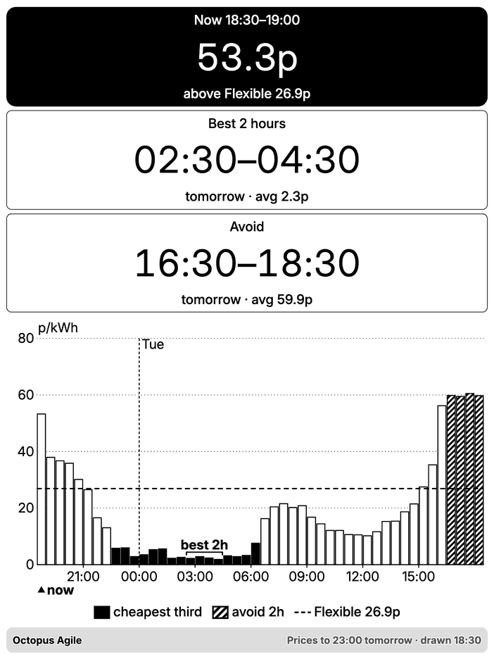 | 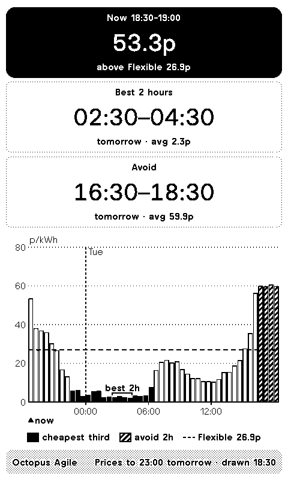 |

## Settings

| Setting | What to enter |
|---|---|
| **Region** | The last letter of your tariff code, e.g. `E-1R-AGILE-24-10-01-C` is C (London). It's shown in the Octopus app under your tariff. |
| **Agile product code** | `AGILE-24-10-01`. Only change it if Octopus launches a newer Agile product. |
| **Flexible unit rate** | Your region's Flexible Octopus rate in p/kWh inc VAT, for the dashed line and the "above/below" note. Clear it to hide both. |

## Run your own copy

The recipe is the easy route, and installs get updates automatically. To run your own private plugin
(needs TRMNL's Developer add-on or a BYOD licence):

1. **Plugins → Private Plugin → Add new.** Strategy **Polling**, verb **GET**, polling URL:
   ```
   https://api.octopus.energy/v1/products/{{ product }}/electricity-tariffs/E-1R-{{ product }}-{{ region }}/standard-unit-rates/?page_size=100&period_from={{ "now" | date: "%Y-%m-%dT%H:%M:00%z" | url_encode }}
   ```
2. Paste the `custom_fields:` list from `src/settings.yml` into **Form Fields**, save, then pick your region (and Flexible rate).
3. Paste the five `src/*.liquid` files into their markup tabs (Shared first) and save each.
4. **Check the data:** markup editor → **Your Variables** → `count` should be the number of
   half-hours from now to the last published one (e.g. 60 at 17:00 once tomorrow is out).
5. Add it to a playlist and **Force Refresh**.

## Development

### Files

The plugin is in `src/`, in TRMNL's [trmnlp](https://github.com/usetrmnl/trmnlp) layout:

| File | What it is |
|---|---|
| `src/shared.liquid` | `agileRender()`, used by every layout (Markup → **Shared** tab) |
| `src/full.liquid`, `src/half_horizontal.liquid`, `src/half_vertical.liquid`, `src/quadrant.liquid` | each layout's markup tab |
| `src/settings.yml` | polling URL, strategy and form fields |
| `.trmnlp.yml` | config for `trmnlp serve` (local dev server); not uploaded |
| `preview.py` | local renderer with live prices and outage simulation |
| `docs/` | the screenshots in this README |
| `icon.png` (from `icon.svg`) | the plugin icon (TRMNL keeps PNG uploads, not SVG) |

Styling is TRMNL Framework classes only, no custom CSS. The boxes are a Framework grid that stacks
in portrait (`portrait:grid--cols-1`), and their text grows on TRMNL X (`lg:`) and in portrait.

### Syncing with TRMNL

The live plugin is connected to this repo with TRMNL's GitHub Sync:

- **TRMNL → GitHub is automatic.** Saving in TRMNL's editor or settings commits `src/` here as
  `trmnl-sync[bot]` ("Updated from TRMNL"), within ~15 s. Those files use CRLF line endings; leave them.
- **GitHub → TRMNL is manual.** After a push that changes `src/`, an import offer appears in the
  **GitHub section of the plugin's settings page** (below Featured Image); accept it there.
  Pushes that only touch files outside `src/` (README, `preview.py`, `docs/`) don't need importing.
- Saving in TRMNL overwrites the plugin's markup and settings there, so pull before editing here.
- The recipe page image is a stored preview: after a design change, click **Generate marketplace
  preview** on the plugin's settings page once TRMNL has redrawn the screen.

### Preview locally

```
python preview.py                                   # all 4 layouts on an OG, now
python preview.py --screen all                      # OG, OG portrait, TRMNL X, X portrait
python preview.py --at 2026-10-19T10:15 --layout full  # a morning (tomorrow not yet published)
python preview.py --at 2026-10-19T15:10 --fetched-at 2026-10-19T12:05  # Octopus offline since 12:05
python preview.py --no-data                         # a poll that returned nothing
```

Run from this folder after `pip install -r requirements.txt && playwright install chromium`.
It renders `src/` with live prices, plus the outage cases TRMNL's own preview can't show, and writes
`screenshots/trmnl-<screen>-<layout>[-HHMM][-polledHHMM][-nodata].png` plus a 1-bit version
approximating the panel. `screenshots/` is ignored by git; copy the ones worth keeping into `docs/`.

## Limits

- The polling payload is up to ~9 kB (62 half-hours after 4pm). TRMNL documents a 5 kB cap for
  webhooks but none for polling.
- When Octopus launches a new Agile version (AGILE-24-10-01 → newer), change the "Agile product code" setting.

## Licence

MIT, see `LICENSE`. Not affiliated with Octopus Energy or TRMNL. Contact: ben@forgerelay.uk
